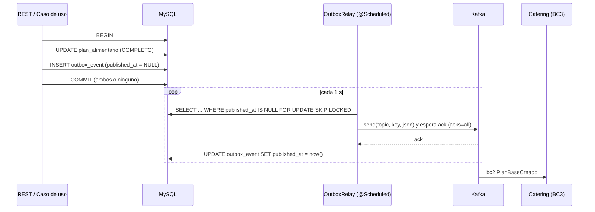

# Patrón Transactional Outbox en MSNutritionPlanner (BC2)

Este documento explica cómo se implementó la comunicación asíncrona por Kafka en
`ms-nutrition-planner` (Spring Boot 4.1, Java 21, **MySQL 8.4**, DDD en 4 capas) y cómo
se garantiza que **ningún evento se pierda**.

## 1. El problema (dual write)

Al completar un plan hay que hacer dos cosas: **guardar el cambio en MySQL** y
**avisar a Kafka**. Son dos sistemas distintos y no existe una transacción que cubra ambos:

| Si se hace… | Falla… | Resultado |
|---|---|---|
| guardar en BD y luego publicar | Kafka está caído | El plan existe pero Catering nunca se entera |
| publicar y luego guardar en BD | la BD hace rollback | Catering recibe un plan que no existe |

## 2. La solución: Transactional Outbox

El evento **se guarda en una tabla de MySQL (`outbox_event`) dentro de la misma
transacción** que el cambio de negocio. Kafka queda fuera de esa transacción: un proceso
aparte (el *relay*) lee la tabla y publica.



**Atomicidad:** o se confirman el plan *y* el evento, o ninguno.
**Si Kafka está caído:** la fila queda pendiente (con `intentos` y `ultimo_error`) y sale
cuando Kafka vuelve. Nada se pierde.

## 3. Dónde está cada pieza (arquitectura DDD)

| Capa | Pieza | Rol |
|---|---|---|
| application | `IntegrationEventPublisher` | **Puerto** de salida. Los casos de uso solo conocen esta interfaz. |
| application | `PlanAlimentarioBaseUseCases.completar`, `PlanAlimentarioPersonalizadoUseCases.completar`, `RecetaUseCases.crear` | Llaman al puerto **dentro de su `@Transactional`**, después de guardar. |
| infrastructure/messaging/out | `OutboxIntegrationEventPublisher` | Adaptador: arma el JSON del contrato y hace `INSERT` en `outbox_event` (`Propagation.MANDATORY`). |
| infrastructure/messaging/out | `EventosSalida` | Records con los campos exactos de `TareaActividad2-tabla-corregida.md`. |
| infrastructure/outbox | `OutboxJpaEntity`, `SpringDataOutboxRepository` | Tabla y consultas (`SKIP LOCKED`). |
| infrastructure/outbox | `OutboxRelay` | Publica en Kafka y marca como publicado. Limpia filas viejas. |
| infrastructure/messaging/in | `PacientesEventosListener`, `CateringEventosListener`, `ProcesadorEventosEntrada` | Consumo + inbox. |
| infrastructure/config | `KafkaConfig` | `@EnableScheduling`, `Clock`, creación de topics. |

El dominio **no sabe nada de Kafka ni de JSON**.

## 4. Eventos

### Publicados por BC2 → topic `bc2.nutricion.eventos`

| Evento | Se registra cuando… | Key del mensaje |
|---|---|---|
| `bc2.RecetaCreada` | se **crea** una receta (`POST /recetas`) | `REC-{id}` |
| `bc2.PlanBaseCreado` | un plan base se **completa** (`estadoPlan = COMPLETO`) | `PLAN-{id}` |
| `bc2.PlanPersonalizadoCreado` | un plan personalizado se **completa** | `PLAN-{id}` |

> Se publica al completar (no al crear) porque el contrato exige `estadoPlan: COMPLETO`;
> un plan `INICIADO` todavía no le sirve a Catering.

Cada mensaje lleva la cabecera Kafka `eventName` y el sobre JSON
(`eventId`, `eventName`, `eventVersion`, `occurredOn`, `source`, `correlationId`, `data`).

### Consumidos por BC2

| Topic | Evento | Efecto en BC2 |
|---|---|---|
| `bc1.pacientes.eventos` | `bc1.PacienteRegistrado` | upsert en `paciente_ref` |
| | `bc1.AntecedenteClinicoRegistrado` | upsert en `antecedente_clinico_ref` |
| | `bc1.NutricionistaRegistrado` | upsert en `nutricionista_ref` |
| | `bc1.EvaluacionRealizada` | guarda `evaluacion_ref`; si `requiereAjustePlan` marca `ajuste_plan_pendiente` |
| | `bc1.ProximaEvaluacionProgramada` | actualiza datos de `paciente_ref` |
| `bc3.catering.eventos` | `bc3.SuscripcionCancelada` | **desactiva el plan personalizado** (`idPlan` `PLAN-205` → 205) |

Los demás eventos de esos topics se ignoran por la cabecera `eventName`.

## 5. Garantías y por qué funcionan

| Garantía | Mecanismo |
|---|---|
| No se pierden eventos | Fila en `outbox_event` en la misma transacción; el relay reintenta hasta el ack de Kafka. |
| Entrega *at-least-once* | La fila se marca publicada **solo después** del ack (`acks=all` + `.get(timeout)`). Si el proceso cae justo antes del commit, se republica. |
| Sin duplicados lógicos | **Inbox**: tabla `inbox_event` con PK `event_id`. El consumidor descarta un `eventId` ya procesado, en la misma transacción que aplica el efecto. |
| Orden por agregado | Misma `key` → misma partición; si falla un evento, los siguientes de ese agregado esperan al próximo ciclo. |
| Varias réplicas | `SELECT … FOR UPDATE SKIP LOCKED` (MySQL 8): cada réplica toma filas distintas. |
| Productor sin duplicados de red | `enable.idempotence=true`. |
| Mensajes inválidos no bloquean | Los mal formados o que rompen reglas de negocio se registran y descartan; los errores técnicos se reintentan. |
| `correlationId` | `CorrelationContext` lo propaga: el del evento recibido se reutiliza en los emitidos como reacción. |

## 6. Esquema MySQL

Lo crea Hibernate (`ddl-auto=update`) o el script
[`db/V2__eventos_integracion_outbox.sql`](../db/V2__eventos_integracion_outbox.sql).

```sql
CREATE TABLE outbox_event (
  id BIGINT AUTO_INCREMENT PRIMARY KEY,
  event_id VARCHAR(36) NOT NULL UNIQUE,   -- = eventId del sobre
  event_name VARCHAR(100) NOT NULL,
  topic VARCHAR(150) NOT NULL,
  message_key VARCHAR(100) NOT NULL,
  payload LONGTEXT NOT NULL,              -- sobre JSON completo
  created_at DATETIME(6) NOT NULL,
  published_at DATETIME(6) NULL,          -- NULL = pendiente
  intentos INT NOT NULL DEFAULT 0,
  ultimo_error VARCHAR(500) NULL,
  KEY idx_outbox_pendientes (published_at, id)
);
```

## 7. Configuración (`application.properties` / variables de entorno)

| Propiedad | Variable | Por defecto | Descripción |
|---|---|---|---|
| `app.kafka.enabled` | `KAFKA_ENABLED` | `false` | Activa relay y listeners. En `false` los eventos igual se guardan en el outbox. |
| `spring.kafka.bootstrap-servers` | `KAFKA_BOOTSTRAP_SERVERS` | `localhost:9092` | Dentro de Docker: `kafka:29092`. |
| `app.kafka.topic` | `KAFKA_TOPIC` | `bc2.nutricion.eventos` | Topic de salida. |
| `app.kafka.consumo.pacientes-topic` | `KAFKA_TOPIC_PACIENTES` | `bc1.pacientes.eventos` | Entrada BC1. |
| `app.kafka.consumo.catering-topic` | `KAFKA_TOPIC_CATERING` | `bc3.catering.eventos` | Entrada BC3. |
| `app.outbox.poll-delay-ms` | `OUTBOX_POLL_DELAY_MS` | `1000` | Frecuencia del relay. |
| `app.outbox.batch-size` | `OUTBOX_BATCH_SIZE` | `50` | Filas por ciclo. |
| `app.outbox.retention-days` | — | `7` | Días que se conservan las filas ya publicadas. |

## 8. Cómo probarlo

```bash
mvn clean package -DskipTests
docker build -t ms-nutrition-planner:latest .
docker compose up -d
```

1. Aplicar `db/V2__eventos_integracion_outbox.sql` solo si `ddl-auto` no es `update`.
2. En Swagger (`http://localhost:7000/swagger-ui.html`): crear una receta con
   `porcionGramos` e `ingredientes` (cantidad/unidad), crear un plan base, agregar día y
   tiempo de comida, y `PUT …/completar`.
3. Ver los mensajes en Kafka UI: `http://localhost:8085` → topic `bc2.nutricion.eventos`.
4. Revisar la tabla: `SELECT id, event_name, message_key, published_at, intentos FROM outbox_event;`
5. **Probar la resiliencia:** `docker compose stop kafka`, completar otro plan (responde 200,
   la fila queda con `published_at NULL`), luego `docker compose start kafka` y comprobar que sale sola.
6. **Probar el consumo:** publicar un `bc3.SuscripcionCancelada` de ejemplo:

```bash
docker exec -i nutrition-kafka /opt/kafka/bin/kafka-console-producer.sh \
  --bootstrap-server kafka:29092 --topic bc3.catering.eventos \
  --property parse.key=true --property key.separator='|' <<'EOF'
SUS-501|{"eventId":"3f2a0013-9c1e-4b7a-a1d2-7e5f0c8b1013","eventName":"bc3.SuscripcionCancelada","eventVersion":"1.0","occurredOn":"2026-11-23T03:59:59Z","source":"MsCateringSubscription","correlationId":"corr-baja-SUS-501","data":{"idSuscripcion":"SUS-501","idPaciente":"PAC-1024","idPlan":"PLAN-205","tipoBaja":"VENCIMIENTO","motivo":"Finalización del periodo contratado","fechaEfectiva":"2026-11-22","entregasPendientesAnuladas":0}}
EOF
```

> Este ejemplo no envía la cabecera `eventName`; el listener la deduce del campo del sobre.
> Repetir el mismo comando no tiene efecto: el `eventId` ya está en `inbox_event`.

## 9. Cambios de dominio que exigieron los contratos

| Dato del contrato | Dónde se agregó |
|---|---|
| `porcionGramos` de la receta | `Receta`, `RecetaRequest/Response`, columna `receta.porcion_gramos` |
| `cantidad` y `unidad` por ingrediente | VO `IngredienteCantidad`, `UnidadMedida`, `IngredienteRecetaRequest`, columnas en `receta_ingrediente` |
| `idPaciente` del plan personalizado | `PlanAlimentarioPersonalizado`, `CrearPlanPersonalizadoRequest`, columna `plan_alimentario.id_paciente` |
